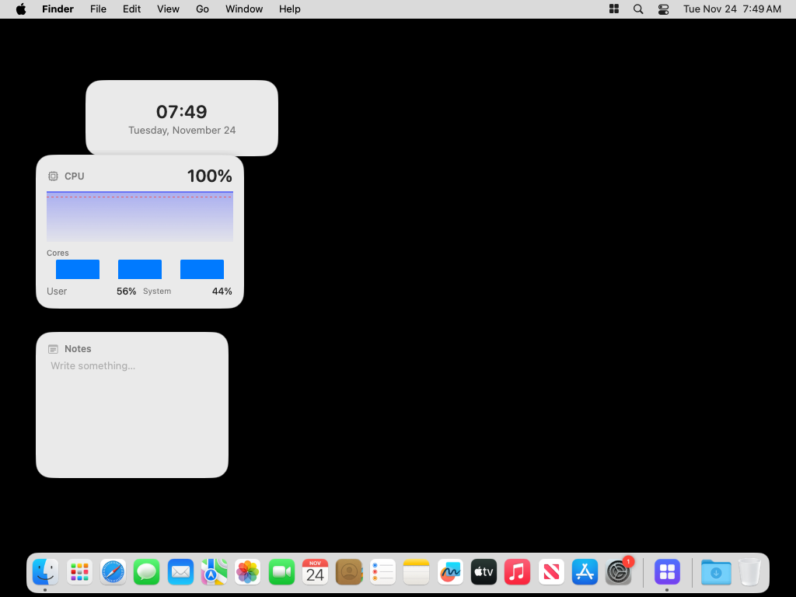
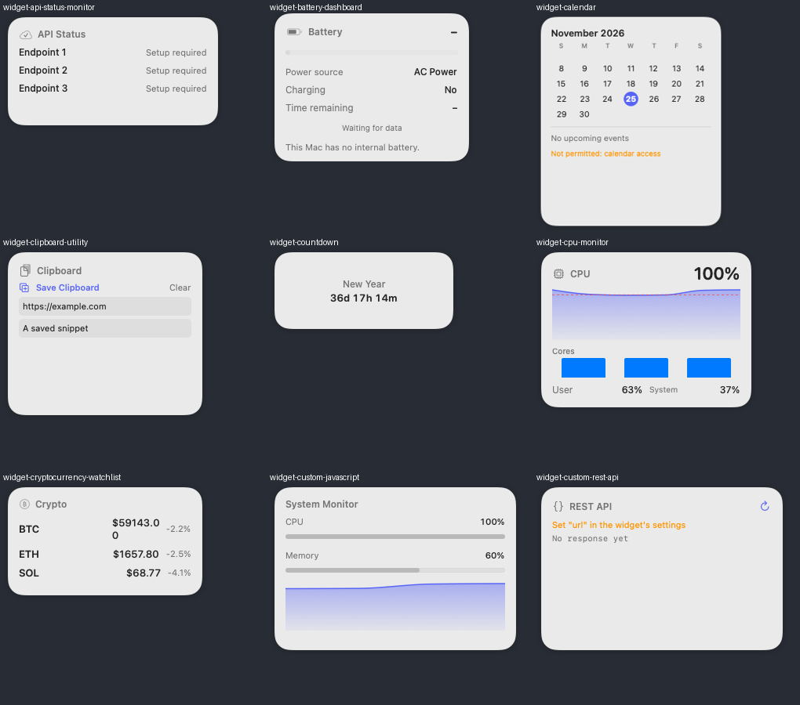
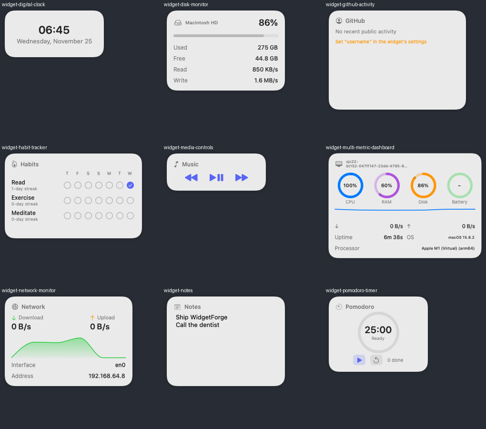
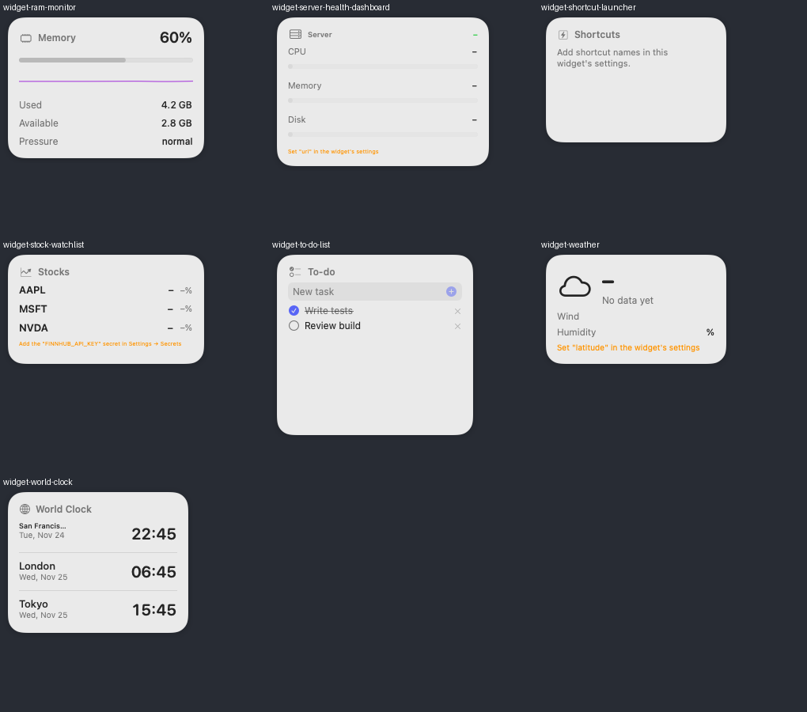
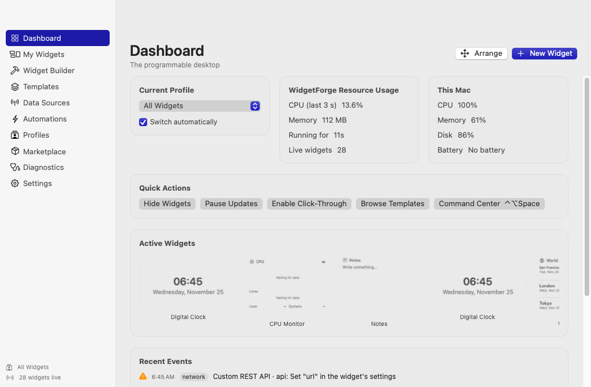
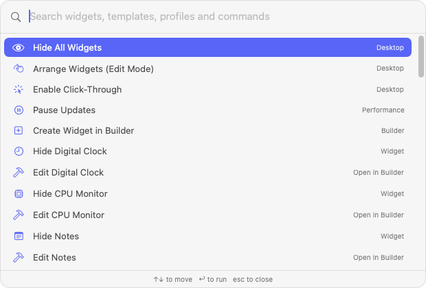

# Progress

Last updated: 2026-11-26.

## How to read this

Development happened on a Linux machine with no Swift toolchain, so every compile and test result below
comes from GitHub Actions (`.github/workflows/widgetforge.yml`) on hosted macOS 15 / Xcode 16.4 runners
and a Swift 5.10 Linux container. Columns:

- **Implemented**: the code exists in this repository.
- **Compiled**: it builds in CI as part of `WidgetForge.app` or the widget extension.
- **Tested**: automated unit tests exercise it (`swift test`), or the app self-test does.
- **Hardware verified**: a person has used it on a real Mac. **Nobody has yet**, so this column is "no"
  everywhere. The nearest substitute is the CI self-test and its screenshot on a virtual Mac, noted where
  it applies.

## Measured results

From CI run [45350436518](https://github.com/sknitd/test/actions/runs/45350436518) (commit `4291b12`), macOS 15.8.2,
Xcode 16.4, GitHub-hosted 3-core Apple-silicon virtual Mac, one 1024×684 @1x display, no battery.

**Build and package**

| | |
| --- | --- |
| Core unit tests | pass on macOS 15 and on Linux (Swift 5.10) |
| `WidgetForge.app` | Release, universal (`x86_64 arm64`), ad-hoc signed, signature valid, 19 MB, widget extension embedded |
| `WidgetForge.dmg` | 6.2 MB, `hdiutil verify` VALID |

**Self-test** (`WidgetForge --self-test`: real app, first launch, the three starter widgets: Digital Clock,
CPU Monitor, Notes)

| Measure | Value |
| --- | --- |
| Overlay windows | 3 created, all visible and on the active Space, level −2147483602 (desktop-icon level + 1) |
| Edit mode | all three raised to level 3 (floating), then restored |
| Move + resize through the store | applied to the live window (frame matched to within 1 pt) |
| App CPU, 10 s in the background | 2.1% of one core |
| App CPU, 8 s with an activity assertion (no App Nap) | 1.3% of one core |
| Memory footprint (`phys_footprint`) | 26.1 MB |
| Widget update latency (data arrival → published to views) | mean 1.15 ms, max 8.9 ms, n = 12 |
| Metric sampling | 13 samples in ~26 s at the configured 2 s interval |
| Network requests made | 0 (no network widget installed; the app is offline by default) |
| Script watchdog symbol | present |
| Errors logged | none |

Caveats on these numbers:

- The runner was **saturated during the measurement**: `top`, run alongside as an independent check, reported
  0.0% idle (65% user / 35% system, mostly Spotlight indexing after the build). The app's CPU widget showed
  100% (72% user / 28% system over a slightly different window), so its reading agrees with `top`. App CPU
  and latency were therefore measured on a busy machine and are probably pessimistic; they are one run on
  one virtual machine, not a benchmark.
- "Background" and "active" phases came out the same within noise. Whether macOS App Naps the process when
  its widgets are covered was not determined.
- Script execution time is instrumented (`script.run`) but no scripted widget ran in the self-test, so there
  is no figure for it. The unit tests show the SDK example executes and that a `while(true){}` script is
  terminated within the configured limit.

**Screenshot from that run** (taken by `screencapture` on the runner):



It shows the widgets drawn on the desktop above the wallpaper, the menu bar item (grid icon, top right) and
the Dock icon. The clock is offset because the self-test had just moved and widened it.

**Bugs the self-test and screenshot found (fixed)**

1. `ProcessInfo.hostName` made macOS show "Allow WidgetForge to find devices on local networks?" and blocked
   the metrics sampler behind the prompt. Replaced with `gethostname()`.
2. Two metric samples taken milliseconds apart produced a meaningless 100% CPU reading. Samples covering
   fewer than five ticks per core are now ignored.
3. Per-core bars were drawn at a fixed thin width; labels in narrow rows wrapped mid-word.

## UI review from rendered snapshots

CI run [45562304087](https://github.com/sknitd/test/actions/runs/45562304087) ran the app in `--ui-snapshots` mode:
38 images covering all 25 templates live, nine main-window sections, the builder (empty, with a small
document, with a template) and the Command Center. All of them rendered. From the same run:

| Check | Result |
| --- | --- |
| Edit-mode move with synthesized mouse events | widget moved by exactly (160, 96) pt; window matched the store |
| Edit-mode resize from the bottom-right handle | resized, but the origin shifted (bug, fixed below) |
| Scripted template (Custom JavaScript), trusted | ran 4 times: mean 46 ms, max 176 ms (first run), wall clock on a saturated host |
| Live network template (Cryptocurrency Watchlist) | 1 request to CoinGecko, succeeded, prices shown |
| Templates needing setup | each showed its setup message instead of data (weather, stocks, GitHub, API status, server health, REST) |
| Errors logged | none |

Problems visible in the images, all fixed in the following commit: the builder's inspector was clipped
in a 1024 pt window and two toolbar buttons were truncated; the Diagnostics timing card wrapped its values
into a column; crypto prices and long host names wrapped; the weather template showed a bare "%" with no
data; the battery template showed an empty chart on a Mac with no battery; "Setup required" was shown on
templates that work immediately; My Widgets and Dashboard thumbnails showed "Waiting for data" instead of
the live widget. With all 25 templates running, the Diagnostics page showed much higher app CPU and update
latency than the three-widget self-test; that was during window captures on a saturated runner and is not
a usable measurement.







These images predate the fixes above.

## Feature status

| Feature | Implemented | Compiled | Tested | Hardware verified | Known limitations |
| --- | --- | --- | --- | --- | --- |
| App shell, menu bar item, main window with 10 sections | yes | yes | launch only (self-test) | no | UI never seen by a person |
| Launch at login (`SMAppService`) | yes | yes | no | no | |
| Desktop overlay windows (levels, Spaces behaviour, click-through, opacity, appearance) | yes | yes | self-test reports live windows and levels | no | Show Desktop / Stage Manager behaviour unknown |
| Move / resize / snap / guides in Edit mode | yes | yes | layout maths unit-tested; CI drives the edit overlay with synthesized mouse events | no | Real pointer input untested |
| Lock, pin, hide, restore, duplicate, delete with trash | yes | yes | unit | no | |
| Group, align, distribute, saved layouts | yes | yes | unit | no | |
| Layout persistence across launches (SQLite) | yes | yes | unit (incl. on-disk SQLite) | no | |
| Multi-display placement, disconnect / reconnect | yes | yes | unit | no | Only one display exists in CI |
| Sleep / wake / display sleep suspension | yes | yes | suspend/resume unit-tested in the data engine | no | Notifications themselves untested |
| Clock widget | yes | yes | renders in CI screenshot | no | |
| CPU monitor (real `host_processor_info` data) | yes | yes | unit (real machine) + self-test | no | |
| Notes widget (persists text) | yes | yes | state persistence unit-tested | no | Typing in a non-activating panel untested |
| All 25 templates | yes | yes | validated by unit tests; all rendered live in CI snapshots | no | Online ones need setup; see each template |
| System metrics: CPU, memory, storage, network, battery, system | yes | yes | unit (real machine) | no | Battery path only exercised as "no battery" in CI |
| Declarative runtime (components, placeholders, actions) | yes | yes | unit (model layer) | no | SwiftUI rendering untested |
| Swift Charts (line, bar, area, pie/donut, sparkline, thresholds, tooltips, CSV export) | yes | yes | no | no | |
| Data engine (REST, WebSocket, local HTTP, files, CSV, calendar, metrics) | yes | yes | unit (mock transports) | no | Real endpoints never contacted by tests |
| Caching, retry/backoff, rate limiting, offline fallback, validation | yes | yes | unit | no | |
| Permission manifests, allowlists, revocation | yes | yes | unit | no | |
| Keychain secrets bound to hosts | yes | yes | unit (in-memory store) | no | Real Keychain untested |
| Import / export, schema validation, secret scrubbing | yes | yes | unit | no | |
| Visual builder (palette, canvas, inspector, layers, undo/redo, copy/paste, guides, constraints, data binding, script editor, console, live preview) | yes | yes | canvas maths; rendered in CI snapshots | no | Gestures and keyboard untested; largest untested surface |
| JavaScript SDK and runtime | yes | yes | unit on macOS (incl. loop termination) | no | In-process; SPI watchdog; see SECURITY.md |
| WidgetKit extension, App Intents, shared snapshot | yes | yes | snapshot hand-off unit-tested | no | Needs team signing to share data; never seen in the gallery |
| Automation engine (8 triggers, 10 actions) | yes | yes | unit | no | System notifications feeding it untested |
| Profiles (manual, time, app, display, restore) | yes | yes | unit | no | |
| Command Center + global shortcut | yes | yes | fuzzy search unit-tested | no | |
| Diagnostics (log, timings, resource usage) | yes | yes | unit + self-test output | no | |
| Optional AI builder | yes | yes | unit (mock transport) | no | Never called a real model |
| Themes (6) | yes | yes | unit | no | Menus never clicked |
| Tidy Up (tile to an edge) | yes | yes | unit | no | Menus never clicked |
| Backup and restore | yes | yes | unit (codec, store and profile replacement) | no | Save/open panels and the confirmation alert untested |
| Sustained-metric automation trigger | yes | yes | unit | no | |
| URL scheme and Shortcuts actions | yes | yes | parser unit-tested | no | Never invoked from Shortcuts or a browser |
| UI snapshot mode and synthesized drag check | yes | yes | runs in CI | n/a | Images need a human eye |
| Release `.app` (universal, ad-hoc signed) | yes | yes | built and launched in CI | no | Not notarised |
| DMG | yes | n/a | created and verified by `hdiutil` in CI | no | Not notarised |

## Acceptance criteria

| Criterion | Status |
| --- | --- |
| Native macOS app builds | **Yes** in CI: Release, universal, with the WidgetKit extension |
| Menu bar integration works | The menu bar item is visible in the CI screenshot; its menu has **not been operated by a person** |
| Desktop widgets render | **Yes** in CI: three widgets visible at desktop level (screenshot above) |
| Widgets can be moved and resized | **Yes** with synthesized mouse events in CI (move exact; resize fixed after the review) and through the store. Dragging with a real pointer is **unverified** |
| Layouts persist | Unit-tested through SQLite, including reopening the database file |
| Clock widget works | **Yes** in CI: shows the runner's time and date in the screenshot |
| CPU monitor uses real metrics | **Yes**: live reading in the screenshot, cross-checked against `top` on the same machine |
| Notes widget saves user content | State persistence unit-tested; typing itself unverified |
| Widget builder works | Renders correctly in CI snapshots with a document loaded; model logic unit-tested; **gestures and keyboard unverified** |
| Data sources update correctly | Unit-tested with mocks, including polling, suspension and failure paths |
| Profiles work | Unit-tested |
| Permissions are handled correctly | Unit-tested at every enforcement point listed in SECURITY.md |
| Tests pass | Yes: all core suites pass on macOS 15 and Linux in CI |
| Unsupported features are documented | Yes: LIMITATIONS.md, COMPATIBILITY.md |
| Core app works offline | Yes by construction: no network use without a network widget; tests make no network calls |
| No critical known crashes | None known: the app ran ~30 s in CI with no errors logged. That is far from proof; interactive use is untested |
| Installation instructions exist | Yes: BUILD.md |

## Blockers encountered

1. **No macOS build tools locally, and installing a Swift toolchain in the development sandbox was
   declined.** Fallback: all compiling and testing was done through GitHub Actions.
2. **`macos-14` hosted runners cancel immediately** (image retired). CI uses `macos-15`. Consequence:
   the app has not been run on macOS 14 itself, only built for it.
3. **No signing identity.** Builds are ad-hoc signed; notarisation and team-signed App Group sharing are
   documented but not exercised.

## Next steps (in priority order)

1. Run the app on a real Mac and walk through "Not verified on real hardware" in LIMITATIONS.md; fix
   what breaks. Start with Edit-mode dragging and text entry in Notes.
2. Sign both targets with a development team and confirm the WidgetKit widget reads the snapshot and
   its buttons round-trip through `pending.json`.
3. Add XCUITest coverage for the builder and the overlay.
4. Build the XPC script host described in SECURITY.md.
5. Developer ID signing and notarisation in CI (needs secrets).

Resume command for an agent continuing this work:

```
Read WidgetForge/docs/PROGRESS.md and LIMITATIONS.md, then continue from "Next steps". Verify every
change with the WidgetForge GitHub Actions workflow (core tests, app build, self-test) before reporting.
```
